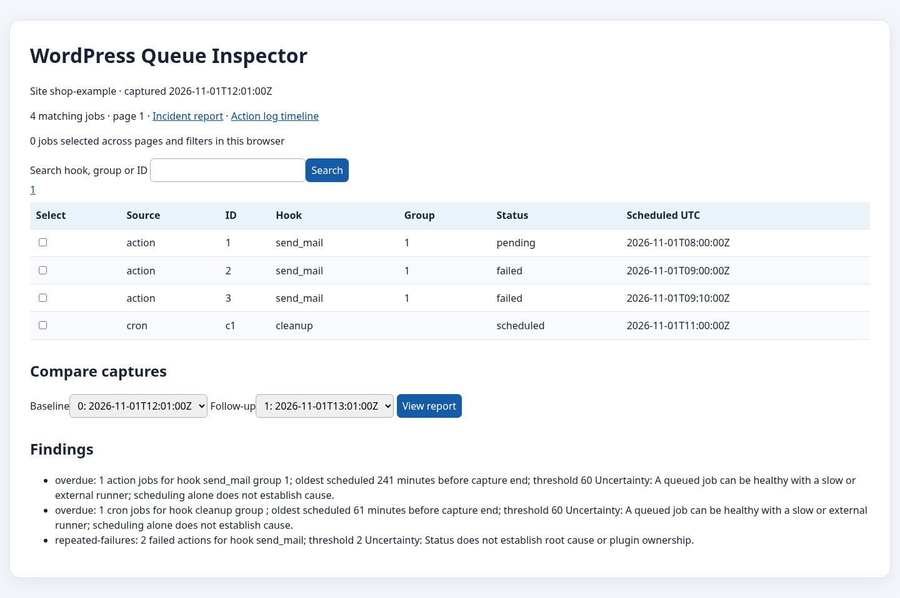

# WordPress Queue Inspector

A local incident workspace for WP-Cron and Action Scheduler evidence. It never runs, deletes or reschedules jobs. Bring in two read-only snapshots, see cautious findings, and document what changed. It uses only the Python standard library for analysis and a WP-CLI bootstrapped PHP exporter for collection.



## Quick start

Python 3.10+:

```sh
python3 -m wqi inspect samples/baseline.json
python3 -m wqi compare samples/baseline.json samples/followup.json
python3 -m wqi new ./my-incident samples/baseline.json samples/followup.json --notes 'Runner checked separately'
python3 -m wqi history ./my-incident
python3 -m wqi compare ./my-incident --baseline-index 0 --followup-index 1
python3 -m wqi report ./my-incident --format html --output report.html
python3 -m wqi backup ./my-incident my-incident.zip
python3 -m wqi restore my-incident.zip ./restored-incident
python3 -m wqi serve ./my-incident
```

Open `http://127.0.0.1:8765/` for the searchable, paginated local browser view and report. The server binds to loopback only; Ctrl-C stops it. Use `add` to append later snapshots. The history command lists capture indices; comparisons must use an older baseline and later follow-up. Use `backup` and `restore` for a portable ZIP. `incident.json` contains SHA-256 checks for every snapshot file; a restored copy is verified on open. Reports are intended for review before sharing.

## Collect from a site

Only an operator with separate authorization should run the exporter. With WP-CLI installed and a disposable or approved WordPress site, run:

```sh
wp eval-file exporter/wqi-export.php /absolute/path/baseline.json SITE_PSEUDONYM --hook=init
```

Run it again after the operator's own investigation with a different output path. The exporter does not install a plugin or call mutating queue APIs. WordPress and plugin bootstrap may itself have side effects. It selects Action Scheduler rows in pages and reads the WP-Cron array. It omits action arguments, log messages, claim data, site URL, secrets, and paths. Hook names and IDs may still be sensitive; review exported files and reports. The pseudonym must be stable across captures. Missing Action Scheduler tables produce partial coverage, not a healthy verdict. Hard bounds are 100,000 actions, 500,000 retained logs and 64 MiB per snapshot. Truncated captures are marked partial. The source's counts are reconciled to rows; changes during capture can make a count partial. No lock is taken.

## Interpretation

An overdue item means its scheduled time is more than 60 minutes before capture end while pending/scheduled. Two failed actions on the same hook produce a repeated-failure finding. Findings state evidence and uncertainty. `DISABLE_WP_CRON` may coexist with a valid external runner. The app does not infer plugin ownership, PHP causation, or runtime dependencies from names. A vanished action is only **no longer observed**. Missing history, pruned logs and partial captures limit conclusions. Recurring WP-Cron events use hook, recurrence and group fingerprint; collisions are marked ambiguous. Timestamps must include UTC offset.

The browser view supports keyboard navigation via native controls, persists selected job IDs across pages and searches in browser local storage, and shows 100 jobs per page. The capture comparison form lets you choose an older and later capture. CLI and browser use the same core. This is an offline evidence viewer, not a live queue manager.

## Data and limits

Snapshot format is documented in [SCHEMA.md](SCHEMA.md). Imported data is untrusted: no code execution, PHP serialization or raw HTML rendering. JSON files are limited to 64 MiB and 100,000 jobs. The incident directory and reports stay local unless the operator shares them. The program has no network client or analytics. Python 3.12 on Linux and the named disposable WordPress configuration in [TESTING.md](TESTING.md) were exercised; other platforms need separate validation.

## Development

See [DEVELOPMENT.md](DEVELOPMENT.md), [CHANGELOG.md](CHANGELOG.md), and [SECURITY.md](SECURITY.md). MIT license.
